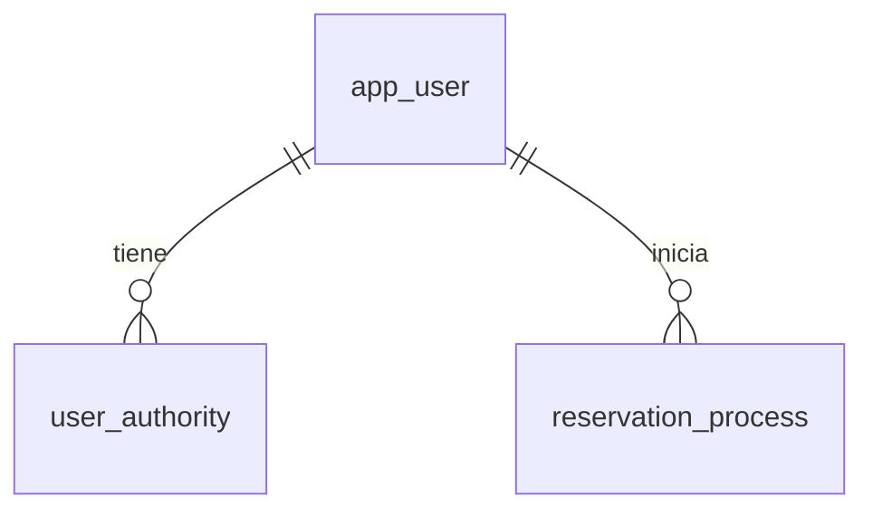

# Persistencia propia de reservas — RES-02

Decisiones aprobadas: PostgreSQL, migraciones Flyway SQL y un registro por
proceso que incorpora los datos de la reserva cuando se conocen.



`V1__crear_usuarios_y_procesos_reserva.sql` crea el esquema. Spring Boot aplica
Flyway antes de que Hibernate valide las entidades con `ddl-auto=validate`.
Las migraciones aplicadas no se editan: los cambios posteriores llevan una
versión nueva. No hay tablas ni conexiones al catálogo.

- `app_user`: identidad local, hash de contraseña, datos del usuario,
  activación y fechas de creación/actualización. Login y email informado son
  únicos sin distinguir mayúsculas; las autoridades pertenecen al backend.
- `user_authority`: autoridades por usuario, sin duplicados.
- `reservation_process`: propietario obligatorio por FK local, slot, progreso,
  vencimiento e información histórica mínima. El ID local existe antes de
  contactar cátedra. `holdId`, `reservationProcessId` y `reservationId` son
  opcionales hasta obtenerlos y únicos cuando se informan; los dos primeros
  son texto opaco, no UUID. `professionalId` es una referencia externa sin FK
  al catálogo. No se agrega una restricción única de slot local: la cátedra
  decide ocupaciones y una nueva tentativa puede suceder a un proceso vencido.

Los slices `usuario` y `procesoreserva` mantienen modelos Lombok sin framework,
puertos de salida, entidades JPA separadas, mappers y adaptadores. Se partió
del generador hexagonal y se retiró el CRUD web y de aplicación: este cambio
solo prepara persistencia; no publica usuarios, hashes ni operaciones de negocio.
No se crean casos de uso vacíos para operaciones aún no implementadas.

Las consultas de procesos expuestas por el puerto requieren el propietario.
Eso permite comprobar aislamiento en persistencia; la identidad autenticada y
su autorización se incorporarán en los casos de uso de RES-04 y reservas.
`@Version` evita sobrescribir silenciosamente cambios concurrentes del proceso.
Las transacciones están acotadas al adaptador y las lecturas son `readOnly`.

La máquina de estados y sus transiciones todavía no están implementadas:
`status` conserva progreso textual no vacío, sin prometer reglas de transición.
Deduplicación de eventos, recuperación y publicación Kafka corresponden a sus
issues. Las fechas de auditoría las debe suministrar el backend; no hay DTO
público que permita elegirlas.

Los tamaños de columnas son decisiones de almacenamiento, no una especificación
del registro KMP. Falta confirmar sus validaciones: el anexo describe restricciones
del registro técnico de cátedra y no debe copiarse como registro de usuario final.
El adaptador recibe un hash; el hashing y el registro se implementarán en RES-03.

## Verificar

```bash
./mvnw-local compile
./mvnw-local verify
```

Las pruebas usan PostgreSQL real con Testcontainers. Comprueban arranque con
migraciones y validación JPA, persistencia de autoridades, duplicados de identidad,
propietario obligatorio, búsquedas por propietario, enriquecimiento del mismo
proceso, unicidad del identificador externo y rechazo de actualizaciones obsoletas.
