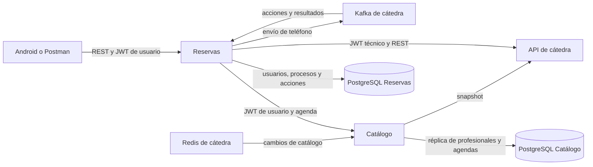

# Arquitectura y operación de Reservas

Reservas registra usuarios, calcula turnos disponibles y sigue el proceso de reserva hasta su confirmación o cancelación. Cátedra decide la ocupación, el bloqueo y el resultado final. El backend usa Java 25, Spring Boot y PostgreSQL propio con migraciones Flyway.

Los slices de `src/main/java/reservas` separan usuarios, consultas a Catálogo, disponibilidad, procesos de reserva y configuración de la integración con cátedra. Los controladores invocan los casos de uso a través de servicios. Los adaptadores implementan los puertos de salida hacia PostgreSQL, HTTP y Kafka. `disponibilidad` combina agendas de Catálogo con ocupaciones de cátedra para una fecha. Catálogo se encarga de leer Redis para mantener al día su réplica. En el Compose integral las aplicaciones comparten una red y cada PostgreSQL tiene su red, volumen y migraciones propios.

## Modelo local

| Tabla | Contenido |
| --- | --- |
| `app_user` | Perfil y hash de contraseña. Login y correo únicos sin distinguir mayúsculas. |
| `user_authority` | Roles asignados al usuario. |
| `reservation_process` | ID local, dueño, turno, ID de hold, ID de proceso e ID de reserva de cátedra cuando existen. Guarda vencimiento, estado y versión para concurrencia. |
| `reservation_action` | Eventos por `event_id`, identificadores de correlación, partición, offset, resultado de aplicación y estado de envío del teléfono. |

El proceso pertenece a un usuario. Los IDs externos de hold, proceso y reserva son únicos cuando están presentes. Las acciones se asocian con el proceso por sus identificadores externos. [Migraciones Flyway](../src/main/resources/db/migration)

## Contratos y estados

- `POST /api/register` crea el usuario local. `POST /api/authenticate` recibe `username` y `password` y devuelve `id_token`. `GET /api/account` consulta la cuenta del titular.
- `GET /api/professionals/{id}/availability?date=YYYY-MM-DD` devuelve `availableSlots` y `versionAplicada`. Usa `America/Argentina/Buenos_Aires`, rechaza fechas pasadas y descarta las horas de hoy que ya transcurrieron. Un turno visible puede ocuparse antes de crear el hold.
- `POST /api/appointment-holds` crea el proceso local y, si cátedra acepta, devuelve `201 HELD` con vencimiento e ID local. `POST /api/appointment-holds/{id}/confirm` solicita la confirmación y puede devolver `202 WAITING_FOR_PHONE`.
- `GET /api/appointment-holds/{id}/phone` permite consultar el pedido. `POST` en la misma ruta envía el número por Kafka. `202 PUBLISHED` indica que Kafka aceptó el mensaje. Si falta el acuse, `OUTCOME_UNKNOWN` conserva el intento para revisión. Al vencer el pedido, `PHONE_WINDOW_CLOSED` impide otro envío.
- `GET /api/appointment-holds/{id}` devuelve el estado local. Kafka puede llevarlo a `CONFIRMED`, `EXPIRED`, `INVALID` o `CANCELLED`. `PHONE_REJECTED` permite corregir el número durante la ventana vigente.
- `GET /api/appointments?page=0&size=20` filtra en cátedra y verifica el dueño local de cada resultado. Si una fila no se puede verificar, toda la página devuelve `502`. `POST /api/appointments/{id}/cancel` usa el ID local y acepta un motivo opcional.
- `CREATE_UNKNOWN`, `CONFIRM_UNKNOWN` y `CANCEL_UNKNOWN` representan resultados indeterminados. El cliente puede consultar el último estado guardado si recibió el ID local. Una falla de persistencia local devuelve `503 RESERVAS_UNAVAILABLE`.

Reservas descubre los recursos de Kafka con `GET /api/student/integration`. Con estado `PROVISIONED`, consume acciones en `alumnos.turnos.acciones.{groupId}` y publica el teléfono en `catedra.turnos.telefono.{groupId}`. El envío usa `reservationProcessId` como clave Kafka y `requestEventId` para identificar el pedido de teléfono. [Adaptador Kafka](../src/main/java/reservas/integracion/infrastructure/kafka/KafkaCatedraAdapter.java)

## Seguridad

- La API usa Spring Security sin sesiones. Los recursos privados requieren un JWT RS256 válido con `ROLE_USER`. El sujeto identifica al usuario y las operaciones verifican su asociación local con el proceso. Reservas reenvía a Catálogo el JWT con la audiencia de Catálogo. La clave privada queda en Reservas y Catálogo verifica con la pública. [Configuración de seguridad](../src/main/java/reservas/shared/infrastructure/config/SecurityConfiguration.java)
- Las contraseñas de usuarios se almacenan con Argon2. El JWT técnico común a ambos backends se carga desde un archivo externo de solo lectura. Mantener claves, JWT y `.env` fuera del repositorio. Evitar credenciales, teléfonos y cuerpos completos en los logs.
- El Compose publica servicios en localhost por defecto y usa HTTP para desarrollo dentro de las redes configuradas. Para acceso externo de clientes, la publicación debe terminar TLS con un certificado válido y usar HTTPS. El acceso al entorno de cátedra requiere VPN. El protocolo de Kafka se configura según lo que ofrece el broker.
- `SecurityConfiguration` no tiene una lista CORS configurada. Android nativo y Postman no hacen preflight de navegador. Si se publica un cliente web en otro origen, se debe configurar una lista de orígenes, métodos y cabeceras para ese despliegue.
- Los DTO validan formato y tamaño de credenciales y datos de registro. La disponibilidad valida el ID y la fecha, y el hold también valida la hora. El teléfono admite entre 7 y 15 dígitos con `+` opcional. El motivo de cancelación admite hasta 500 caracteres. Los errores exponen códigos de operación sin datos técnicos de las dependencias.

## Concurrencia, idempotencia y recuperación

La versión del proceso protege las transiciones concurrentes de confirmación y cancelación. El listener de Kafka correlaciona acciones por `reservationProcessId` y `holdId`. Persiste por `eventId` y confirma el offset después de que la acción quede registrada. Si el acuse falla y el broker reentrega, el evento registrado evita aplicar dos veces la transición. El envío de teléfono conserva su identificador y estado de publicación para evitar reenvíos ante resultados inciertos. [Consumidor de acciones](../src/main/java/reservas/procesoreserva/infrastructure/kafka/AccionesReservaListener.java)

Al arrancar, se vuelven a procesar los resultados de Kafka guardados que siguen pendientes. `ProgramarRecuperacionReservas` inicia además una revisión periódica con `RESERVAS_RECUPERACION_INTERVALO`, de 60 segundos por defecto. `RecuperacionReservasService` revisa hasta diez procesos por tanda y reconcilia con el listado REST de cátedra por paciente y fecha cuando conoce el ID de proceso externo. La consulta alcanza hasta tres páginas de veinte resultados por proceso. Un hold sin confirmar pasa a `EXPIRED` al superar su vencimiento conocido. Una respuesta vacía o ambigua conserva el estado pendiente. Si una caída impide persistir eventos, reiniciar el servicio tras resolver la causa permite volver a leer los offsets pendientes. Para reconstruir un hold remoto se necesitan sus identificadores. [Servicio de recuperación](../src/main/java/reservas/procesoreserva/application/service/RecuperacionReservasService.java)

## Ejecutar y verificar

Con JDK 25 y Docker, ejecutar `./mvnw verify` desde Reservas. Para el JDK local configurado, usar `./mvnw-local verify`. La suite usa PostgreSQL en Testcontainers, claves de prueba y simulación de contratos externos. Cubre registro, login, disponibilidad, holds, resultados, idempotencia, recuperación, aislamiento de usuarios e indisponibilidad de PostgreSQL. Las pruebas locales no necesitan VPN ni credenciales de cátedra.

| Área | Prueba de referencia |
| --- | --- |
| Registro y JWT | [Registro](../src/test/java/reservas/RegistroUsuarioIntegrationTest.java) y [autenticación](../src/test/java/reservas/AutenticacionIntegrationTest.java) |
| Disponibilidad | [Agenda, ocupaciones y errores de integración](../src/test/java/reservas/DisponibilidadIntegrationTest.java) |
| Reservas | [Holds, resultados Kafka, propiedad y recuperación](../src/test/java/reservas/ProcesoHoldIntegrationTest.java) |
| Arranque y caída de base | [Readiness, liveness y respuestas HTTP](../src/test/java/reservas/ServiceBootstrapTest.java) |

El perfil `verificacion` del Compose integral comprueba readiness, registro, login y comunicación con Catálogo. Para recorrer el flujo en Postman, iniciar sesión en Reservas, usar el `id_token` como Bearer, consultar disponibilidad, crear el hold, confirmar, esperar el pedido de teléfono y consultar el resultado. Con cátedra habilitada se necesita la VPN y el JWT técnico por archivo externo. [Ejecutar ambos backends](../README.md#ejecutar-ambos-backends--res-13)
